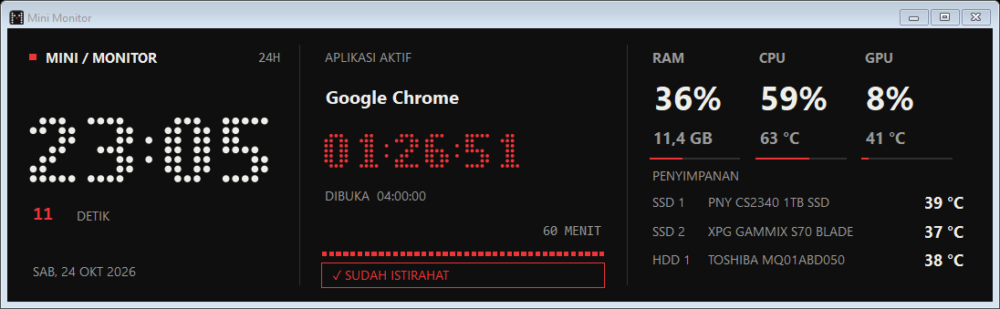

# Mini Monitor 3.5.6

Monitor Windows ringan untuk jam, durasi aplikasi aktif, RAM, CPU, GPU, suhu SSD/HDD, dan FPS game dalam satu tampilan. Mendukung mode overlay dan jendela yang dapat diubah ukurannya, empat tema, tray menu, startup Windows, serta pengingat satu jam.



## Instalasi

Unduh dan jalankan [`Installer/MiniMonitor-Setup-3.5.6-x64.exe`](Installer/MiniMonitor-Setup-3.5.6-x64.exe). Installer bersifat offline dan berisi aplikasi, pembaca sensor, PresentMon, serta installer PawnIO opsional untuk sensor CPU.

Checksum SHA-256 tersedia di [`Installer/SHA256.txt`](Installer/SHA256.txt). Windows 10 versi 2004+ atau Windows 11 x64 dan .NET Framework 4.7.2+ diperlukan.

## Pengingat istirahat

Setelah 60 menit aktif, klik **✓ SUDAH ISTIRAHAT** atau bar pengingat untuk mengulang hitungan pengingat. Total waktu aktif tetap lanjut; pengingat berikutnya muncul setelah 60 menit aktif penuh sejak konfirmasi. Bunyi delapan nada bergantian berlangsung sekitar 2,4 detik, terpisah dari bunyi pergantian jam.

Setiap satu jam aktif juga memunculkan tiga gelombang kembang api pixel dari tengah panel selama **6 detik**. Warna mengikuti tema; efek tetap berjalan saat suara dimatikan. Klik **SUDAH ISTIRAHAT** menghentikan efek. Klik kanan > **Efek pengingat pixel** untuk aktif/nonaktif atau **Coba efek** untuk preview tanpa mengubah hitungan. Efek dilewati saat tersembunyi, minimized, atau Windows terkunci. Timer animasi hanya hidup selama efek berlangsung.

## Pendinginan GPU

- Tombol es di samping suhu GPU menjalankan kipas NVIDIA 100% selama 15 detik lalu memulihkan pengaturan sebelumnya.
- Tombol power pada panel jam langsung menjalankan pendinginan yang sama lalu mematikan Windows setelah pemulihan berhasil.
- Tombol bulan pada panel jam menjalankan pendinginan yang sama lalu membuat Windows masuk Sleep.
- Klik tombol aktif sekali lagi untuk membatalkan hitung mundur.
- Kegagalan, penutupan aplikasi, atau pengendali lain seperti FireStorm yang mengambil alih akan membatalkan shutdown maupun Sleep.

Kontrol kipas menggunakan NVML dan tidak mengubah voltage, power limit, atau overclock. Dukungan bergantung pada GPU dan driver.

## Isi repository

| Lokasi | Isi |
| --- | --- |
| `Installer/` | Installer offline terbaru, checksum, dan petunjuk singkat. |
| `MiniMonitor/` | Runtime, dependensi build, lisensi pihak ketiga, dan panduan penggunaan. |
| `Source/` | Source C#, skrip build installer, serta pengujian otomatis. |
| `Pratinjau/` | Gambar tampilan rilis terbaru. |

Build aplikasi:

```powershell
powershell -File .\Source\Build.ps1
```

Build installer:

```powershell
powershell -File .\Source\Installer\Build-Installer.ps1
```

Panduan lengkap ada di [`MiniMonitor/PANDUAN.txt`](MiniMonitor/PANDUAN.txt). Proyek ini terinspirasi tampilan dot-matrix dan bukan produk resmi Nothing, Casio, atau ZOTAC.
